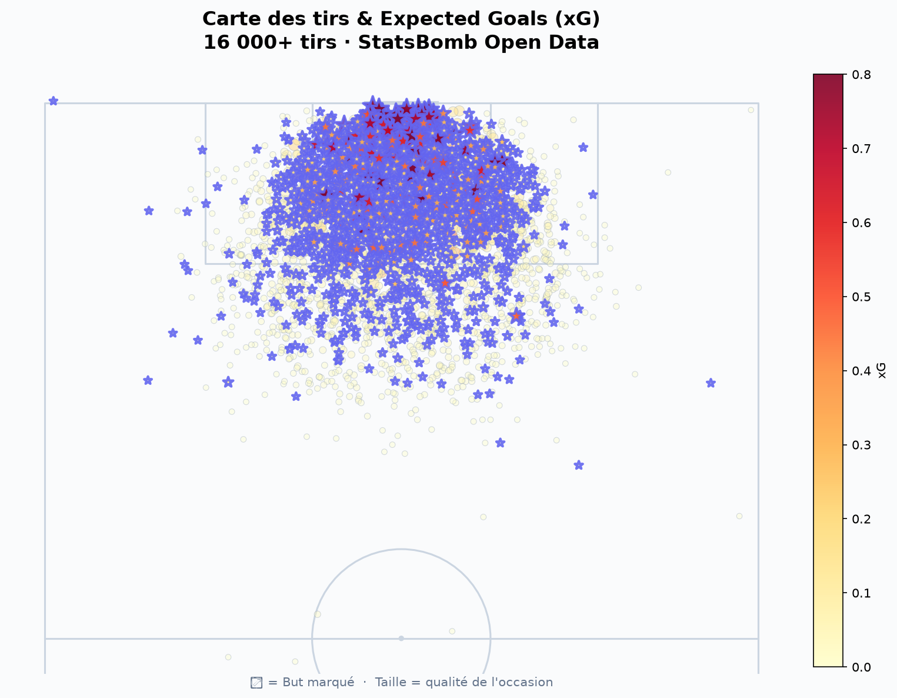
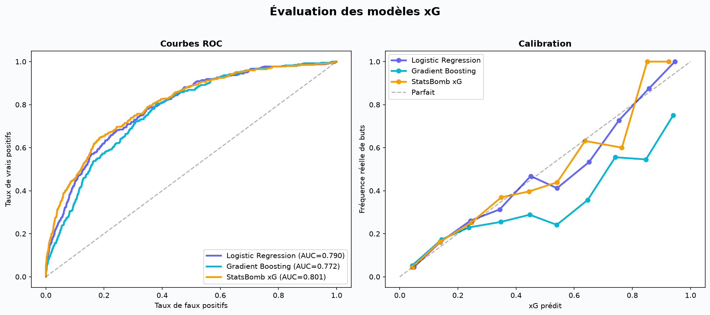
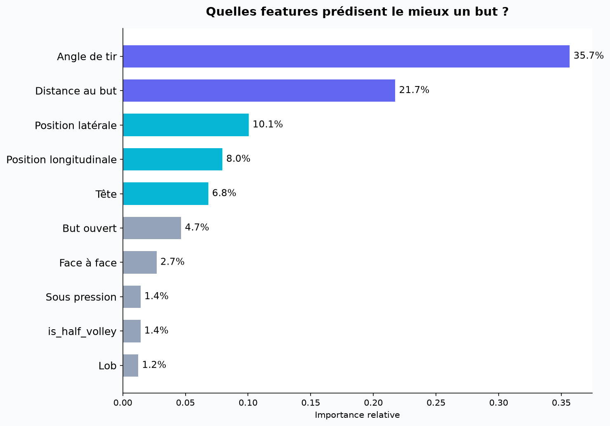
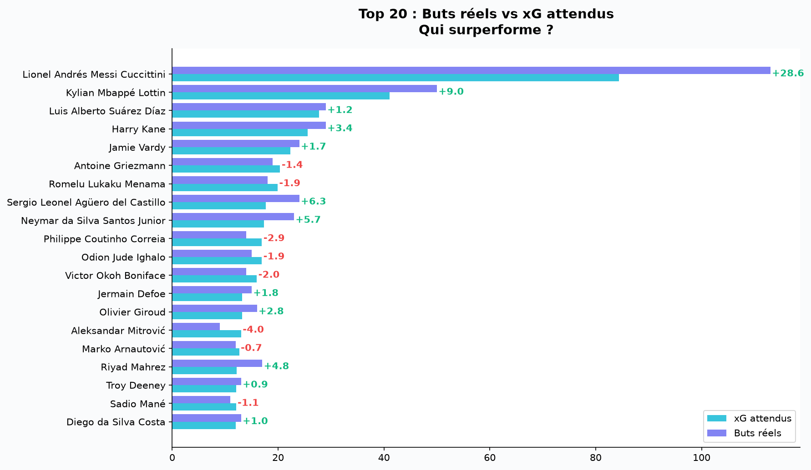

# ⚽ Expected Goals (xG) Model from Scratch

Building an xG model from scratch using StatsBomb open data, Python, and scikit-learn.



## What is xG?

Expected Goals (xG) measures the probability that a shot will result in a goal, based on characteristics like distance, angle, body part, and game situation. It's the most widely used metric in modern football analytics.

## Dataset

- **16,000+ shots** from StatsBomb Open Data
- Competitions: La Liga, Premier League, Ligue 1, Bundesliga, Euro 2024
- Source: [StatsBomb Open Data](https://github.com/statsbomb/open-data)

## Features (19)

| Category | Features |
|----------|----------|
| Spatial | Distance to goal, angle, x/y coordinates |
| Body part | Head, right foot, left foot |
| Shot type | Open play, free kick, counter attack, set piece |
| Situation | First time, follows dribble, one-on-one, under pressure, open goal |
| Technique | Volley, half volley, lob |

## Results

| Model | ROC AUC | Brier Score | Log Loss |
|-------|---------|-------------|----------|
| Logistic Regression | 0.789 | 0.078 | 0.272 |
| Gradient Boosting | 0.772 | 0.083 | 0.285 |
| StatsBomb xG (reference) | 0.801 | 0.075 | 0.264 |

Our simple logistic regression reaches **98.5%** of StatsBomb's performance using only event-level data (no tracking data).

## Key Findings

- **Angle + distance** explain ~60% of shot quality
- **Headers** convert significantly less than foot shots
- **One-on-one** situations multiply scoring probability by ~3x
- **Pressure** reduces shot quality noticeably







## How to Run

```bash
git clone https://github.com/stephdarel/football-xg-model
cd football-xg-model
pip install -r requirements.txt
jupyter notebook xg_model.ipynb
```

## Tech Stack

- Python, pandas, NumPy
- scikit-learn (Logistic Regression, Gradient Boosting)
- mplsoccer, matplotlib
- StatsBomb API (statsbombpy)

## Author

**Stephane Nzati** 

- [LinkedIn](https://www.linkedin.com/in/stéphanenzati)
- [GitHub](https://github.com/stephdarel)

## Data Attribution

Data provided by [StatsBomb](https://statsbomb.com). Free for research and personal use.